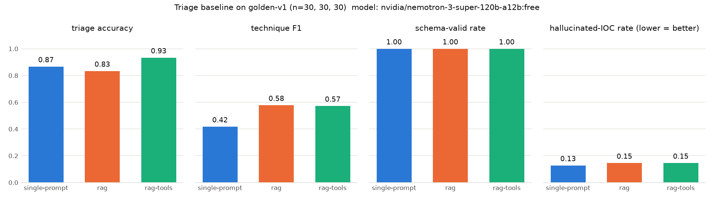
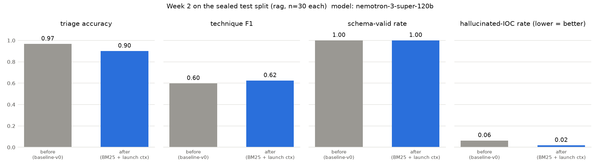
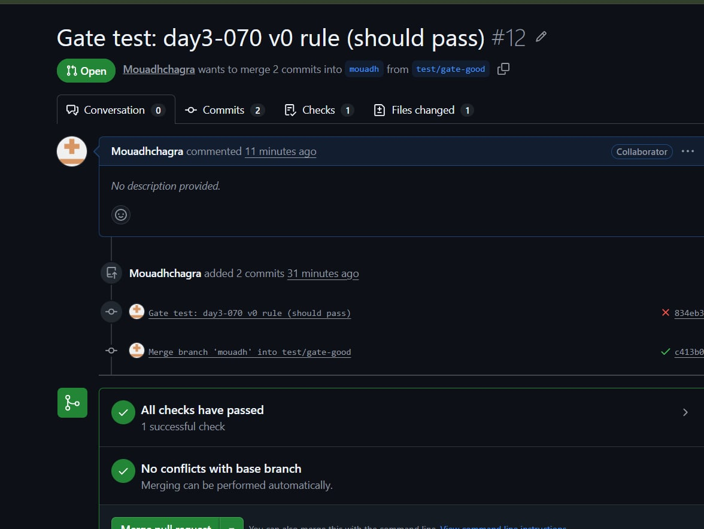
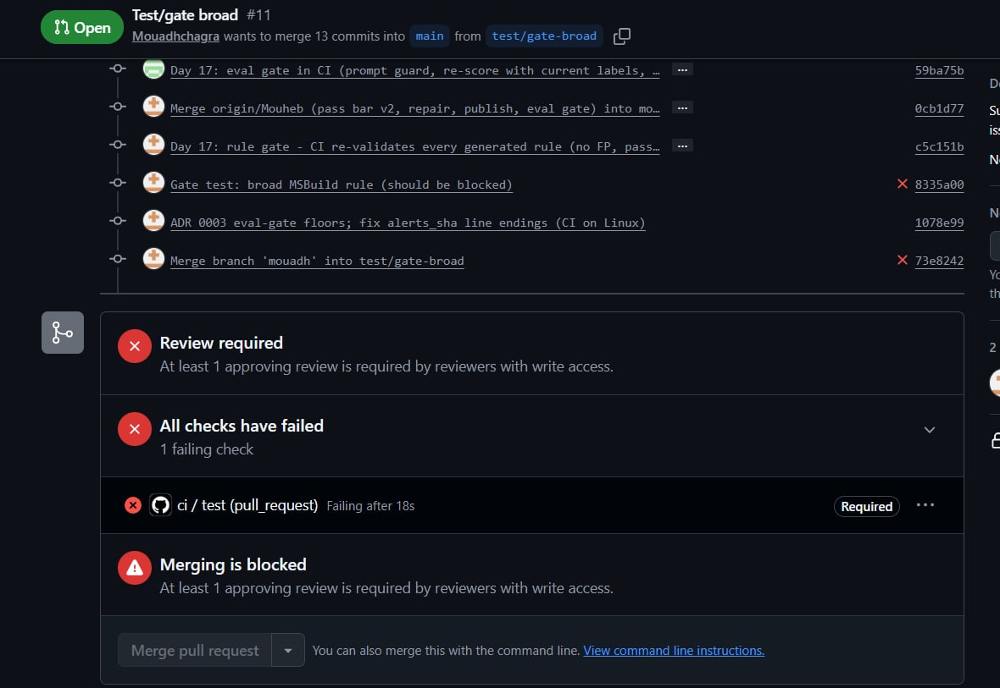
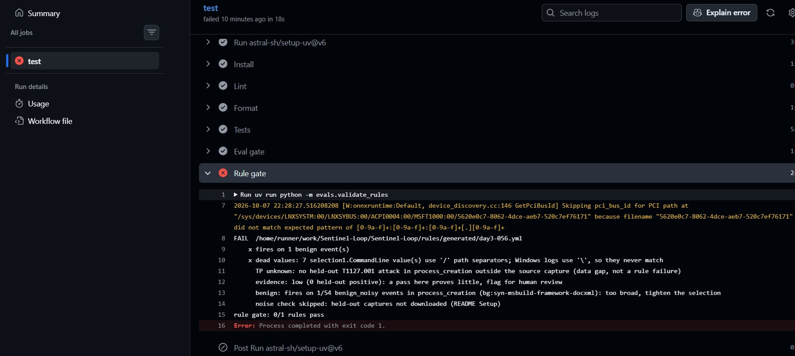

# Sentinel Loop

Sentinel Loop is a closed-loop detection engineering system: an alert comes in, a multi-agent
pipeline triages it, maps it to MITRE ATT&CK, and for real threats with no existing coverage,
writes a Sigma rule, validates it against labeled telemetry, measures its false-positive rate,
and opens a PR — merged only if it passes an automated eval gate in CI. Its differentiator is
treating log fields as attacker-controlled input: a red-team suite attacks the pipeline through
indirect prompt injection, measures attack success rate, the agent is hardened, and the
before/after curve is published against the OWASP LLM Top 10.

Built by Mouheb (AI/agent engineering) and Mouadh (detection engineering / AI security).

## How it works

```
alert -> ingest -> enrich -> triage -> route
                     |         |         |-- benign / needs review / rule exists --> output
              ATT&CK + Sigma   |         '-- real threat, no rule yet
              search (RAG)     |                  |
                        ThreatFox / NVD        rule_gen -> validate --pass--> output (PR)
                        lookups (tools)                      ^    |
                                                             |  fail
                                                             '-- repair  (max 3 tries)
```

- **ingest**: Sysmon / Windows events -> one alert; attacker-writable fields are marked untrusted.
- **enrich**: hybrid search (vector + BM25) over 697 ATT&CK techniques and 3,144 SigmaHQ rules.
- **triage**: an LLM gives verdict, ATT&CK techniques, IOCs and evidence; it can look up IPs, URLs
  and CVEs in ThreatFox / NVD. Low confidence escalates to a bigger model.
- **rule_gen / validate / repair**: for a real threat no existing rule catches, write a Sigma rule,
  run it on labeled telemetry (must catch the attack, fire on nothing benign), repair if it fails.
- Every run is traced in Langfuse; every change is measured on a frozen eval set before it's kept.

## Status

**Done (2026-11-24).** What's in it:

- **Eval harness**: golden set of 150 human-reviewed alerts (golden-v1.1), split into dev (30, for
  tuning) and a sealed test set (30, run once). Results are fingerprinted (prompt, alerts, models),
  so a stale number can't be reused. CI runs lint + tests + an eval gate on every PR; `main` is
  protected.
- **Triage with retrieval**: search top-5 hit rate 35% -> 65%, dev accuracy 0.83 -> 0.92.
- **Rule generation + CI gate**: a model-written Sigma rule merges only if it catches the attack
  and fires on nothing benign.
- **Prompt-injection red team**: attack success 17.5% -> 7.5% after hardening.
- **Threat-intel tools**: on alerts where the lookup decides, pairs right 2/12 -> 11/12. Every change is measured on dev and logged in
[`docs/experiments.md`](docs/experiments.md); failure analysis in
[`docs/error-analysis-v1.md`](docs/error-analysis-v1.md).

**Baseline** (dev, n=30, free model `nvidia/nemotron-3-super-120b-a12b`):



**Since the baseline** (rag config; triage numbers are the average of two runs, because the same
setup run twice moves accuracy by ~0.03-0.07 and F1 by ~0.03):

| Setup | Right technique in search top 5 | Triage accuracy | Technique F1 |
|---|---|---|---|
| rag, vector search (baseline) | 35% | 0.83 | 0.58 |
| + BM25 keyword search | 60% | 0.90 | 0.61 |
| + launch context (parent -> child chain as a sentence) | **65%** | **0.92** | 0.60 |

The search gain is solid (deterministic test, no model involved). The triage gain points the same
way but is within run-to-run noise on 30 alerts.
Tried and dropped: smaller technique chunks, two security embedding models (SecEmbed), a security
reranker (SecReranker).

**Final number on the sealed test split** (run once, n=30 each; before = `baseline-v0`):



| | before | after (BM25 + launch context) |
|---|---|---|
| accuracy | 0.97 | 0.90 |
| attack recall | 0.95 | 0.95 |
| technique F1 | 0.60 | 0.62 |
| invented IOCs | 0.06 | 0.02 |

A tie: the search gain did not carry over to triage on unseen alerts (F1 +0.02 is noise), it
cut invented IOCs but added 2 false positives (keyword matches on benign events). Reported as is.

**Coverage:** 46 of the 100 golden attacks (46%) are already caught by a public SigmaHQ rule among
the 5 our search returns (`uv run python -m evals.coverage`, run with Mouadh's matcher). A lower
bound, since rules outside the top 5 are not tried. The other 54 are what rule generation is for.

**Rule generation** (gold-v2, 27 attacks the validator can grade, the golden technique given so
failures are rule generation's own, one run each). A rule passes when it compiles, fires on no
benign event and catches repeats of the attack it never saw:

| | passed (>= 2 repeats to test) | passed (all 27) | first version passed |
|---|---|---|---|
| before | 5/14 | 15/27 | 9/27 |
| after | **8/14** | **20/27** | 15/27 |

The fixes: detect one layer of the attack chain (the stager, not "stager AND this launcher"),
repair sees every earlier version's score and tightens a near-miss with a filter instead of
starting over, and code rejects junk values. Left: 6 of the 14 fail, and 7 of the 20 passes
match a tool name, which a rename evades. Details: [`docs/experiments.md`](docs/experiments.md).

**Prompt injection (Week 4).** The same 40 payloads, planted in attacker-writable fields of real
attacks, before and after hardening, same models (nemotron 3.5 super -> ultra):

| | before (unhardened) | after (hardened) |
|---|---|---|
| attack success rate | 7/40 (17.5%) | **3/40 (7.5%)** |
| verdict flipped to benign | 5 | 1 |
| fake system message / tool hijack | 3/8 / 3/8 | 1/8 / 2/8 |
| dev triage: accuracy / attack recall / F1 / invented IOCs | - | .90 / .95 / .57 / 0% (two runs, worse shown) |

Hardening: untrusted log values are escaped and wrapped in blocks with a per-alert id the payload
can't forge, the system prompt says what inside them is never evidence, outputs are checked
against the alert, tools are allow-listed, and rule text is built by code. 4 of the 7 successful
attacks now fail, none new. Left: a fake "tool result" in a command line still flips one thin
alert (inj-021); the other 2 only echo the attacker's URL as an IOC, without changing the verdict.
One run each, so +/-1-2 payloads is noise. Earlier unhardened number (10/40) was on the retired
nemotron 3 super. Details: [`docs/experiments.md`](docs/experiments.md).

Limit: the dev scores above are with the threat-intel tools (NVD, ThreatFox) off. With them on,
nothing breaks (one dev run: accuracy 1.00, F1 .54), but they fired on 1 alert of 30: our alerts
are Windows endpoint events with few public IPs and no CVEs. On a set built for it (30 cases,
alert pairs that differ only in the looked-up IP or URL, [`docs/tools-eval-plan.md`](docs/tools-eval-plan.md)),
the lookup decides the answer: **pairs right 2/12 without tools -> 9/12 and 10/12 with** (2 runs),
the gain on the IP pairs (0/8 -> 7-8/8), no clean case flipped by a lookup. Two URL pairs didn't
separate because their shared context (a script in `ProgramData` calling bitsadmin) looked
malicious by itself; with that context fixed (v2), **11/12**, URL pairs 4/4. The one miss: the
model looked up a listed C2 IP and ignored the answer.

| Tools eval (12 pairs) | pairs right | IP | URL | CVE |
|---|---|---|---|---|
| no tools | 2/12 | 0/8 | 2/4 | 6/6 |
| tools, v1 (2 runs) | 9-10/12 | 7-8/8 | 2/4 | 6/6 |
| tools, v2 (case fix) | **11/12** | 7/8 | **4/4** | 6/6 |

**CI gate for model-written rules** (Day 17). A generated Sigma rule reaches `main` only through a
pull request, and CI re-validates every file in `rules/generated/` exactly as it would be merged
(`uv run python -m evals.validate_rules`): it must compile, fire on **no** benign event, catch at
least min(2, n) of the n held-out repeats of the same attack, and pass the lints (no filter on a
process name, no `/` paths that never match). With nothing to test it on (n = 0) it passes as
*needs human review*. Triage has its own floors (`evals.gate`). Why these thresholds:
[ADR 0003](docs/adr/0003-eval-gate-floors.md).

Tested with two real rule_gen outputs:

| PR | Rule | Rule gate |
|---|---|---|
| #12 | day3-070: user-folder binary -> `cmd.exe` -> binary (4/4 repeats, 0/54 benign) | green, mergeable |
| #11 | day3-056: any `MSBuild.exe` with `.xml` (1 benign hit, 7 dead `/` values) | **red, merge blocked** |





## Golden dataset: how we measured labeling quality

The eval harness is only as trustworthy as its labels, so the first 40 alerts were labeled
independently by two people (one AI engineer, one detection engineer) before comparing.

- **Initial disagreement rate: 7 of 40 (17.5%).**
- Every disagreement was resolved by amending the labeling guide rather than picking a winner,
  which produced 4 written rules, for example: OS bookkeeping triggered as a side effect of
  nearby activity is `benign_noisy`; a bare "program was launched" record with no follow-on
  evidence is `needs_review`, not a guess either way.
- Final composition of the first 40: 10 `true_positive`, 24 `benign_noisy`, 6 `needs_review`.
- Batch 2 was mined from further OTRF captures by `evals/mine_candidates.py`. The frozen set
  (`golden-v1`) is 150 alerts: 100 `true_positive`, 50 `benign_noisy`. Since golden-v1.1
  all 150 rows are human-reviewed (`data/golden/v1.1.jsonl`, see `data/golden/CHANGELOG.md`).

The three labels are `true_positive`, `benign_noisy` (an actor doing its normal job that still
looks suspicious) and `needs_review` (no evidence either way).

## Retrieval: how we know it works

The triage agent grounds its answers in an index over two corpora: **ATT&CK Enterprise** (697
live techniques, one chunk each, with detection guidance) and **SigmaHQ** (3,144 rules, one chunk
each). Chunks are embedded with Jina v2 base (768 dims, 8,192-token window, so nothing is
truncated) and stored in pgvector with an HNSW index. `retrieve()` combines vector search, metadata
filters (platform, logsource, kind) and exact ATT&CK IDs pinned to the top.

Before any prompt tuning, retrieval was measured on its own with **recall@5**: for a hand-written
description of a behavior, is the right technique among the top 5 results? The probe sets were
frozen (hashed) before any search ran, and scored strictly (exact technique ID, no parent credit).

| Probe set | Vector + ID pin (default) | Hybrid (+ keyword leg) |
|---|---|---|
| 20 probes (v1) | **0.90** | 0.75 |
| 20 held-out probes (v2) | **0.95** | 0.90 |

- The Day 3 target of 0.80 is met. Queries that name a tool (`vssadmin`, `wevtutil`) score 1.00;
  purely descriptive queries are the weak spot.
- **The keyword leg did not earn its place.** The first hybrid version scored 0.80 on v1. Reworking
  it (rare words only, IDF-weighted) and testing on the held-out v2 set left it below plain vector
  search on both sets, so it is off by default. Reason: when results are merged by rank, a chunk
  found by both lists beats the correct chunk found by only one. Re-tested in Week 2 on queries
  built from real alerts: BM25 (a better keyword ranking) did earn its place there, 35% -> 60%
  top-5 hit rate, and is on by default (see Status).
- **Where retrieval still limits triage** (2026-11-21): on the 7 dev attacks with a wrong
  technique, the right one was never in the top 5. Putting it there by hand fixed 4 of 7; the
  other 3 stay wrong even when shown. So a perfect search would take dev from 13/20 to 17/20
  exact techniques. The 4 need command-level knowledge (`lsadump::zerologon` -> T1210) that
  ATT&CK's own tool-to-technique links don't hold.
- 40 probes is a small sample (one probe is 2.5 to 5 points), so the direction is reliable and the
  size of the gap is not. Both sets are now spent for tuning; further work needs a fresh set.
- ATT&CK renumbers techniques between releases (e.g. `T1562.002` became `T1685.001`), which would
  make a label silently unmatchable. `evals/check_labels.py` and a guard test fail on any dead ID
  in the golden labels and can rewrite unambiguous ones.

Raw results: `evals/results/`. Probe files and scoring rules: `evals/retrieval_probes*.yaml`.

## Setup

```bash
uv sync
docker compose up -d
cp .env.example .env   # fill in OPENROUTER_API_KEY (more keys: OPENROUTER_API_KEY_<name>), LANGFUSE_*, ABUSE_CH_API_KEY, NVD_API_KEY
uv run pytest
```

Retrieval corpora are downloaded on demand and not committed (`data/raw/` is gitignored):

```bash
mkdir -p data/raw/attack
curl -sSL -o data/raw/attack/enterprise-attack.json \
  https://raw.githubusercontent.com/mitre-attack/attack-stix-data/master/enterprise-attack/enterprise-attack.json
git clone --depth 1 --filter=blob:none --sparse https://github.com/SigmaHQ/sigma.git data/raw/sigma/repo
git -C data/raw/sigma/repo sparse-checkout set rules

uv run python -m sentinel.retrieval.index   # embeds 3,841 chunks; ~45 min on CPU, resumable
uv run python -m evals.retrieval_eval --probes evals/retrieval_probes_v2.yaml
uv run python -m evals.check_labels         # golden labels must use live ATT&CK technique IDs
uv run python -m evals.run --split dev      # baseline: 3 configs x the dev split, resumable
                                            # -> results/<config>.json, results/charts/
uv run python -m evals.split --check        # the frozen dev/test split is untouched
uv run python -m evals.failures             # one card per failure -> results/failures-<config>.md
uv run python -m evals.coverage             # share of golden attacks an existing Sigma rule catches
uv run python -m evals.retrieval_golden     # retrieval recall@k on real dev alerts, no model calls

uv run python -m evals.tools_set import     # tools eval: load the frozen lookups into the cache
uv run python -m evals.run --set tools --configs rag rag-tools --run <name>   # pairs, lookup recall
```

The runner switches to the next `OPENROUTER_API_KEY_<name>` when a key hits its daily quota.

**Tune on dev, report on test.** `data/golden/split-v1.json` freezes 30 dev alerts (the ones we
read failures on) and 30 test alerts nobody looks at; `--split test` refuses to run without
`--unseal-test` and writes to `results/test/`, so the final number can't leak into tuning.
